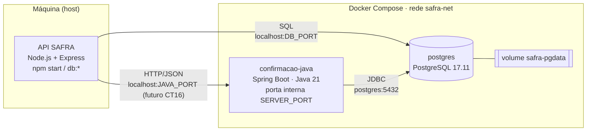

# Safra Online — Backend

<picture>
  <source
    media="(prefers-color-scheme: light)"
    srcset="assets/design/images/banner-safra-backend-dark.png"
  />
  <source
    media="(prefers-color-scheme: dark)"
    srcset="assets/design/images/banner-safra-backend-light.png"
  />
  
</picture>

API responsável pelas regras de negócio, pelo gerenciamento de dados e pela integração dos serviços do Safra Online v2.0, um aplicativo de supermercado digital desenvolvido para fins acadêmicos.

## Sobre o projeto

O **Safra Online** é uma evolução do projeto Safra Online v1.0, criado com o objetivo de modernizar a experiência de compras em um supermercado digital.

A aplicação permite explorar produtos e categorias, gerenciar um carrinho de compras e evoluir por um fluxo estruturado de finalização de pedidos.

Este repositório contém o **backend da aplicação**, responsável por disponibilizar endpoints para o frontend, aplicar regras de negócio, validar informações e gerenciar a persistência dos dados.

A arquitetura também prevê a integração com um serviço complementar desenvolvido em Java e executado em um contêiner Docker, atendendo aos requisitos acadêmicos do projeto sem exigir a migração completa do backend principal.

## Funcionalidades

As funcionalidades previstas para o backend incluem:

- **API REST:** disponibilização de endpoints para comunicação com o frontend.
- **Gerenciamento de produtos:** consulta e organização das informações dos produtos.
- **Categorias e subcategorias:** disponibilização dos dados necessários à navegação pelo catálogo.
- **Carrinho de compras:** suporte às operações relacionadas aos itens selecionados.
- **Processamento de pedidos:** validação dos itens, cálculo dos valores e registro das compras.
- **Compra demonstrativa:** finalização acadêmica sem cobrança e sem coleta de dados financeiros.
- **Persistência de dados:** armazenamento das informações utilizando PostgreSQL.
- **Integração com Java:** comunicação com um serviço complementar desenvolvido com Spring Boot.
- **Assistente com IA:** interpretação opcional de pedidos por texto ou áudio pela API da OpenAI, com validação no catálogo local.
- **Ofertas demonstrativas:** produtos promocionais cadastrados no próprio banco, sem consulta a mercados externos.
- **Tratamento de erros:** respostas padronizadas para facilitar a comunicação com o frontend.

> Esta lista descreve o escopo previsto do projeto. A disponibilidade de cada endpoint e funcionalidade depende do estágio atual da implementação.

## Tecnologias utilizadas

| Tecnologia | Finalidade |
|---|---|
| Node.js | Ambiente de execução do backend principal |
| Express.js | Criação e organização da API HTTP |
| Java | Desenvolvimento do serviço complementar |
| Spring Boot | Estruturação da aplicação Java |
| Docker | Empacotamento e execução do serviço Java em contêiner |
| PostgreSQL | Banco de dados relacional |
| OpenAI API | Interpretação estruturada de pedidos e transcrição opcional de áudio |
| npm | Gerenciamento de dependências do backend Node.js |
| Git | Controle de versão |

## Arquitetura

A aplicação utiliza uma arquitetura híbrida, mantendo o Node.js como backend principal e adicionando um serviço independente em Java.

### Visão geral

```text
Frontend
React Native + Expo
        |
        | HTTP / REST
        v
Backend principal
Node.js + Express.js
        |
        |----------------------|----------------------|
        |                      |                      |
        v                      v                      v
PostgreSQL             Serviço Java           API OpenAI
                       Spring Boot             serviço externo
                       Docker
                            |
                            v
                       PostgreSQL
```

O frontend realiza as requisições ao backend Node.js, que centraliza o catálogo, o carrinho, os cálculos e as integrações. O backend encaminha a confirmação ao serviço Java por HTTP/REST e usa a API externa da OpenAI para o assistente.

O PostgreSQL será utilizado para persistir os dados da aplicação, de acordo com as responsabilidades definidas para cada serviço.

A separação permite incorporar Java e Docker ao projeto sem reescrever toda a aplicação backend.

## Repositório do frontend

O frontend correspondente ao projeto está disponível em:

[pi4-TURMA-gN-frontend](https://github.com/Rnchx/pi4-TURMA-gN-frontend)

## Especificação dos fluxos e contratos

A visão geral e os fluxos ficam em [docs/fluxos do frontend](https://github.com/Rnchx/pi4-TURMA-gN-frontend/tree/main/docs/fluxos). As interfaces definidas por este backend e pelo serviço Java ficam em [`docs/contratos`](docs/contratos).

## Execução do catálogo — Ciclo 2

Requer **Node.js 22 ou superior** e **PostgreSQL 14 ou superior**. O PostgreSQL pode ser o do Docker Compose (veja [Ambiente Docker](#ambiente-docker-postgresql-e-serviço-java)) ou uma instalação local. Não é necessária chave OpenAI. A implementação atual atende catálogo, classificação e detalhes (E1–E3); as demais funcionalidades acima continuam previstas.

1. Instale com `npm ci`.
2. Copie `.env.example` para `.env` e configure o banco: o do Docker Compose (criado com as credenciais do próprio `.env`) ou um banco **já criado**, com um usuário autorizado a criar tabelas. Nenhuma credencial real acompanha o repositório.
3. Execute `npm run db:check`, `npm run db:migrate` e, para dados demonstrativos, `npm run db:seed`.
4. Inicie com `npm start` ou `npm run dev` (reinício ao editar arquivos).

| Variável | Uso |
|---|---|
| PORT | Porta HTTP; padrão 4000. |
| DB_HOST / DB_PORT | Host e porta PostgreSQL; padrões localhost e 5432. |
| DB_NAME | Banco existente; padrão safra. |
| DB_USER / DB_PASSWORD | Credenciais locais; senha passada em objeto de conexão, sem concatenar URI. |
| NODE_ENV | development ou production. |
| CORS_ORIGINS | Origens exatas separadas por vírgula, sem barra final, caminhos ou curingas. |

Em desenvolvimento, o padrão CORS permite `http://localhost:8081`, `http://127.0.0.1:8081` e `http://localhost:19006`. Se usar outra porta ou IP de rede no Expo Web, inclua sua origem exata. Em produção, configure somente as origens publicadas; sem configuração, nenhuma origem de navegador é autorizada. Chamadas sem cabeçalho Origin, como as de apps nativos e ferramentas HTTP, continuam aceitas. CORS controla navegadores e não substitui autenticação.

No frontend, crie seu `.env` local a partir do exemplo e configure `EXPO_PUBLIC_API_URL=http://localhost:4000` para Expo Web neste computador; reinicie o Expo. Para dispositivo físico, use o IP acessível do computador; no Android Emulator, normalmente `http://10.0.2.2:4000`. Não publique credenciais em variáveis EXPO_PUBLIC_.

### Banco e ciclo de vida

- `src/database/index.js` apenas cria/configura o pool; importar módulos não consulta nem cria tabelas.
- `db:check` verifica conexão. `db:migrate` aplica arquivos versionados em transação, com registro em `schema_migrations` e trava contra execução concorrente.
- A primeira migration cria `categorias`, `subcategorias` e `produtos`, alinhadas a CT2/CT4/CT5. Se `categorys` e `products` legadas existirem, importa os registros preservando IDs e cria subcategorias a partir de `type`. As tabelas originais são preservadas como histórico, sem receber novas escritas da API. Faça backup antes de migrar um banco existente.
- Duplicidade de categorias, referências inválidas ou dados incompatíveis com as restrições interrompem e revertem a migration; nenhum dado é apagado ou ajustado silenciosamente. Corrija os dados com revisão antes de tentar novamente.
- `src/database/create-tables.sql` é o arquivo histórico original; não é executado pelo servidor ou pelo migrador. Não o utilize para inicializar novos bancos.
- `db:seed` é explícito e repetível: 58 produtos, 5 categorias e seus tipos/subcategorias. Reutiliza dados/imagens do SQL original; os preços e a validade não têm finalidade comercial. Produtos demonstrativos têm chave fixa; repetir a carga atualiza esses registros sem duplicá-los, preservando IDs e cadastros manuais. As imagens HTTPS externas dependem dos respectivos hosts.
- `npm start` abre HTTP e verifica a conexão, capturando a falha. Não migra nem popula o banco. Consultas possuem limite de tempo; a API volta a atender quando o PostgreSQL retorna.
- SIGINT/SIGTERM encerram HTTP e o pool. `db:check`, `db:migrate` e `db:seed` retornam código 1 em caso de falha, sem imprimir credenciais ou consultas.

### Saúde

| Rota | Banco ativo | Banco desligado |
|---|---|---|
| GET /health/live | 200, http=ok | 200, http=ok |
| GET /health ou /health/ready | 200, http=ok, banco=disponivel | 503, http=ok, banco=indisponivel, codigo e mensagem |

Readiness verifica conectividade; migrations precisam ser aplicadas separadamente. Erros nas consultas do catálogo seguem os contratos: HTTP 500 com `codigo=erroInterno` e mensagem compreensível, sem detalhes SQL, stack trace ou credenciais.

### Rotas oficiais e complementares deste ciclo

| Método e rota | Resposta / finalidade |
|---|---|
| GET /produtos | CT1: totalProdutos e produtos ativos. |
| GET /categorias | CT3: categorias ativas com subcategorias ativas. |
| GET /categorias/:categoriaId/subcategorias/:subcategoriaId/produtos | CT6: valida existência e vínculo da classificação. |
| GET /produtos/:produtoId | CT7: detalhes, preço e classificação do produto ativo. |
| GET /categorias/:categoriaId/produtos | Complemento: produtos ativos da categoria (relacionados). |
| GET /produtos/tipo/:tipo | Complemento: produtos pelo nome do tipo/subcategoria. |
| GET /categorias/:categoriaId | Complemento: categoria por ID. |
| POST /produtos; PUT /produtos/:produtoId | Cadastro e substituição integral dos campos nome, preco, descricao, imagemUrl, categoriaId e subcategoriaId. |
| POST /categorias; PUT /categorias/:categoriaId | Cadastro/alteração de nome (campo nome). |
| DELETE /produtos/:produtoId | Desativa o produto; retorna 204 ou 404. |
| DELETE /categorias/:categoriaId | Remove categoria sem vínculos; 409 se houver dependências. |

As escritas exigem campos completos, texto não vazio e limites de tamanho, preço não negativo com até duas casas e imagem HTTPS sem credenciais. IDs são inteiros positivos de 32 bits; categoria e subcategoria devem existir e ser compatíveis. Os campos de oferta aparecem nas leituras para compatibilidade com os contratos, sempre falsos na demonstração deste ciclo; gestão de ofertas não foi implementada. Listas vazias retornam 200 com array vazio. Erros JSON têm `codigo` e `mensagem`; validação retorna 400, ausência retorna 404, conflito retorna 409. Os cadastros não têm autenticação neste ciclo; não exponha esta API demonstrativa publicamente.

### Aliases temporários para o frontend atual

Não foi necessário alterar o frontend. Estes adaptadores usam os mesmos serviços e repositórios das rotas oficiais e enviam `Deprecation: true`:

| Alias | Equivalente / formato legado |
|---|---|
| GET /products | /produtos; totalProducts e products. |
| GET /products/:id | /produtos/:produtoId; product. |
| GET /products/idcategory/:category | /categorias/:categoriaId/produtos; product como lista. Aceita também a grafia idCategory. |
| GET /products/type/:type | /produtos/tipo/:tipo; product como lista. |
| GET /categorys | /categorias; totalCategorys e categorys. |
| GET /categorys/:id | /categorias/:categoriaId; category. |
| GET /categorys/filter/:category | Resolve o nome da categoria e usa a mesma consulta por categoria; products. |
| GET /products/name/:name; GET /categorys/name/:name | Busca exata por nome; product ou category (lista), respectivamente. |
| POST/PUT/DELETE /products[/:id]; /categorys[/:id] | Mesmas operações de cadastro, atualização e remoção, com serialização legada. |

Produtos legados usam `id, name, price, description, type, validity, photo, idcategory`. Na escrita também é aceito `idCategory`; valores conflitantes são rejeitados. O tipo é associado a uma subcategoria da categoria informada, criada em transação quando necessário. Categorias legadas usam `id, name`. Os aliases permanecem apenas até o frontend adotar os contratos oficiais; não são uma segunda API de regras de negócio.

### Testes

`npm test` executa testes HTTP com Supertest e **PostgreSQL real temporário**, instalado como dependência de desenvolvimento. Não utiliza o DB_* do ambiente, não exige banco externo e não modifica bases existentes. O cluster usa porta livre, autenticação SCRAM, senha aleatória e bind em 127.0.0.1; seus arquivos são removidos após os testes. Instale dependências opcionais e permita o postinstall do pacote de binários `@embedded-postgres/<plataforma>`, caso o gerenciador solicite. Em Linux, rode como usuário sem privilégios de root; o teste não cria usuários do sistema. `npm ci --omit=dev` instala apenas as dependências necessárias ao servidor.

A suíte cobre CT1/CT3/CT6/CT7, aliases, filtros, criação/atualização, entradas inválidas, conflitos, registros inativos, migration do legado, repetição da carga, CORS, saúde, inicialização sem banco e desligamento/recuperação real do PostgreSQL. O teste visual integrado depende do frontend Expo em execução e é documentado no relatório do ciclo.

## Serviço Java com Spring Boot e Docker

O Serviço de Confirmação ([`services/confirmacao-java`](services/confirmacao-java)) é independente do backend Node.js (ADR 0004), executa em contêiner Docker (ADR 0005) e se comunica com o Node por HTTP/REST com JSON. Ele será responsável por CT16 (gerar a confirmação demonstrativa) e por CT17/CT18 (persistir a compra e seus itens).

Neste ciclo existe somente a fundação: inicialização, conexão controlada com o PostgreSQL, saúde (liveness/readiness), erros JSON padronizados e testes. **CT16 ainda não está implementado**: CT17 exige chave estrangeira para `carrinhos.id` (CT9), e o carrinho persistido (CT8–CT15) ainda não existe. Nenhuma rota de confirmação é exposta até lá.

| Item | Valor |
|---|---|
| Linguagem / framework | Java 21 (LTS, Eclipse Temurin) / Spring Boot 4.1.2 |
| Build | Maven 3.9.16 via wrapper versionado (`mvnw`, checksum SHA-256 fixado) |
| Imagem | `safra/confirmacao-java:0.1.0`, build em duas etapas; a final contém só o JRE e o JAR, roda como usuário `safra` (uid 10001) |
| Porta | `SERVER_PORT` (padrão 8080), publicada em `127.0.0.1:${JAVA_PORT}` |
| Perfil | `docker`: banco em `postgres:5432` (nome do serviço na rede `safra-net`) |

| Rota | Banco ativo | Banco desligado |
|---|---|---|
| GET / | 200, `{"servico":"safra-confirmacao",...}` | 200 |
| GET /actuator/health/liveness | 200, `UP` | 200, `UP` (processo vivo) |
| GET /actuator/health/readiness | 200, `UP`, `db: UP` | 503, `DOWN`, `db: DOWN` |
| Outras rotas | 404 `{"codigo":"rotaNaoEncontrada","mensagem":"Rota não encontrada."}` | igual |

O Actuator expõe somente `health`, sem detalhes (URL JDBC, versões ou credenciais). Erros seguem o formato `{"codigo", "mensagem"}` dos contratos, sem stack trace. Logs vão para stdout/stderr (`docker compose logs`). O encerramento é gracioso: no SIGTERM, o Tomcat para de aceitar conexões, conclui as requisições ativas (até 20 s) e fecha o pool. O código de saída 143 é o normal da JVM para SIGTERM.

### Relação com o exemplo cliente-servidor ("Fazedor de Continhas")

| Conceito do exemplo | Adaptação no SAFRA |
|---|---|
| Servidor iniciado antes do cliente | Compose sobe o Java depois do PostgreSQL saudável; o Node é iniciado depois |
| Servidor aguardando solicitações | Spring Boot escutando HTTP em `SERVER_PORT` |
| Host e porta por argumento | Variáveis de ambiente (`DB_HOST`, `DB_PORT`, `SERVER_PORT`, `JAVA_PORT`) |
| Sockets e objetos serializados | HTTP/REST com JSON |
| Threads manuais por cliente | Pool de threads do Tomcat gerenciado pelo Spring Boot |
| Tratamento de indisponibilidade | Readiness 503 com banco fora; Node deverá tratar o Java fora do ar (CT16) |
| Desligamento manual | `docker compose stop` envia SIGTERM e o encerramento é gracioso |

## Ambiente Docker: PostgreSQL e serviço Java



- **Node roda na máquina**; Java e PostgreSQL rodam no Docker.
- O **Node usa `localhost`** e as portas publicadas: `DB_HOST=localhost`, `DB_PORT` (5432) e, no futuro, `http://localhost:${JAVA_PORT}` para o Java.
- O **Java usa `postgres`** como hostname: é o nome do serviço na rede interna `safra-net`, e a porta interna é sempre 5432.
- **`localhost` dentro do contêiner Java é o próprio contêiner**, e não a máquina nem o PostgreSQL. Por isso o Compose fixa `DB_HOST=postgres` para o Java, independentemente do `.env`.
- As portas são publicadas só em `127.0.0.1`, inacessíveis a outros computadores da rede. O frontend não faz parte deste Compose.

| Serviço | Imagem | Porta na máquina | Healthcheck |
|---|---|---|---|
| `postgres` | `postgres:17.11-alpine3.24` (oficial) | `127.0.0.1:${DB_PORT:-5432}` | `pg_isready` |
| `confirmacao-java` | `safra/confirmacao-java:0.1.0` (build local) | `127.0.0.1:${JAVA_PORT:-8080}` | readiness do Actuator |

Volume nomeado `safra-pgdata` (dados do PostgreSQL), rede `safra-net` e política `restart: unless-stopped`.

### Comandos

Verificar o Docker:

```bash
docker version
docker compose version
```

Criar o `.env` (ignorado pelo Git) a partir do exemplo e trocar `DB_USER`/`DB_PASSWORD` por valores próprios. O Compose cria o banco com eles na primeira inicialização do volume:

```bash
cp .env.example .env
```

Validar a configuração, construir e iniciar (o build executa os testes Java):

```bash
docker compose config --quiet
docker compose build
docker compose up -d
```

Estado, healthchecks e logs:

```bash
docker compose ps
docker inspect --format "{{.State.Health.Status}}" safra-postgres-1 safra-confirmacao-java-1
curl http://localhost:8080/actuator/health/liveness
curl http://localhost:8080/actuator/health/readiness
docker compose logs -f confirmacao-java
docker compose logs postgres
```

Migrations e seed do Node (na máquina, usando o PostgreSQL do Docker), depois a API:

```bash
npm run db:check
npm run db:migrate
npm run db:seed
npm start
```

Parar **sem apagar dados** (o volume `safra-pgdata` é mantido) e retomar:

```bash
docker compose stop
docker compose start
docker compose down
```

Reconstruir somente o serviço Java após alterar o código:

```bash
docker compose up -d --build confirmacao-java
```

Remover o ambiente **e apagar o banco** (irreversível, use somente de forma intencional):

```bash
docker compose down -v
```

Se o volume já existir, alterar `DB_USER`/`DB_PASSWORD` no `.env` não muda o usuário do banco: o PostgreSQL só usa essas variáveis ao inicializar um volume vazio.

### Testes do serviço Java

O `docker compose build` executa os testes que não dependem do banco (contexto, liveness, readiness indisponível, Actuator restrito e erros JSON). Para incluir os testes com o PostgreSQL do Compose, em execução, rode na raiz do backend (Git Bash):

```bash
set -a; . ./.env; set +a
MSYS_NO_PATHCONV=1 docker run --rm --network safra-net \
  -e SAFRA_TESTE_COM_BANCO=1 -e DB_HOST=postgres -e DB_PORT=5432 -e DB_NAME -e DB_USER -e DB_PASSWORD \
  -v "$(pwd -W)/services/confirmacao-java:/src:ro" -v safra-m2-cache:/root/.m2 \
  eclipse-temurin:21.0.13_9-jdk-alpine-3.24 sh -c 'cp -r /src /w && cd /w && sh mvnw -B test'
```

Em Linux/macOS, use `$(pwd)` no lugar de `$(pwd -W)` e omita `MSYS_NO_PATHCONV=1`.

## API e comunicação com o frontend

O backend disponibiliza a camada de comunicação utilizada pelo frontend do Safra 2.0.

As rotas deverão ser organizadas de acordo com os recursos da aplicação, mantendo separação entre endpoints, regras de negócio, acesso a dados e tratamento de erros, conforme a arquitetura adotada.

As operações de checkout deverão validar os dados no servidor, recalcular o valor total dos produtos e registrar o pedido de acordo com as regras definidas.

O sistema não processa pagamentos reais, não simula PIX ou cartão e não solicita dados financeiros. A finalização apenas registra e exibe uma confirmação demonstrativa.

## Decisões de arquitetura

As principais decisões técnicas do projeto são documentadas por meio de Architecture Decision Records (ADRs).

Os documentos ficam organizados no diretório:

```text
docs/adr/
```

Cada ADR descreve o contexto de uma decisão, a solução escolhida, as alternativas consideradas e suas consequências.

Essa documentação ajuda a manter as decisões arquiteturais explícitas e facilita a compreensão da evolução do sistema pela equipe.

## Desenvolvimento acadêmico

**Projeto Integrador IV**

O Safra 2.0 é desenvolvido em equipe para fins acadêmicos, com o objetivo de aplicar conhecimentos de desenvolvimento backend, APIs REST, bancos de dados relacionais, integração entre serviços, conteinerização e arquitetura de software.

## Licença

Projeto desenvolvido para fins acadêmicos. As condições de distribuição e reutilização deverão seguir as definições estabelecidas pela equipe e pela instituição de ensino.
