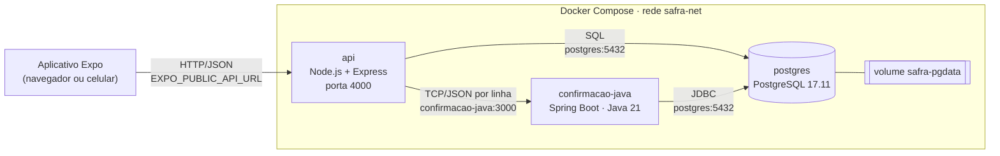

# Safra Online — Backend

<picture>
  <source
    media="(prefers-color-scheme: light)"
    srcset="assets/design/images/banner-safra-backend-dark.png"
  />
  <source
    media="(prefers-color-scheme: dark)"
    srcset="assets/design/images/banner-safra-backend-light.png"
  />
  
</picture>

API responsável pelas regras de negócio, pelo gerenciamento de dados e pela integração dos serviços do Safra Online v2.0, um aplicativo de supermercado digital desenvolvido para fins acadêmicos.

## Sobre o projeto

O **Safra Online** é uma evolução do projeto Safra Online v1.0, criado com o objetivo de modernizar a experiência de compras em um supermercado digital.

A aplicação permite explorar produtos e categorias, gerenciar um carrinho de compras e evoluir por um fluxo estruturado de finalização de pedidos.

Este repositório contém o **backend da aplicação**, responsável por disponibilizar endpoints para o frontend, aplicar regras de negócio, validar informações e gerenciar a persistência dos dados.

A arquitetura também prevê a integração com um serviço complementar desenvolvido em Java e executado em um contêiner Docker, atendendo aos requisitos acadêmicos do projeto sem exigir a migração completa do backend principal.

## Funcionalidades

As funcionalidades previstas para o backend incluem:

- **API REST:** disponibilização de endpoints para comunicação com o frontend.
- **Gerenciamento de produtos:** consulta e organização das informações dos produtos.
- **Categorias e subcategorias:** disponibilização dos dados necessários à navegação pelo catálogo.
- **Carrinho de compras:** suporte às operações relacionadas aos itens selecionados.
- **Processamento de pedidos:** validação dos itens, cálculo dos valores e registro das compras.
- **Compra demonstrativa:** finalização acadêmica sem cobrança e sem coleta de dados financeiros.
- **Conta do consumidor:** cadastro, autenticação, perfil com foto, troca de senha e exclusão permanente.
- **Restrição etária acadêmica:** nascimento persistido como `DATE` e idade calculada pelo Java na adição e no checkout de produtos 18+.
- **Persistência de dados:** armazenamento das informações utilizando PostgreSQL.
- **Integração com Java:** comunicação com um serviço complementar desenvolvido com Spring Boot.
- **Assistente com IA:** interpretação opcional de pedidos por texto ou áudio pela API da OpenAI, com validação no catálogo local.
- **Ofertas demonstrativas:** produtos promocionais cadastrados no próprio banco, sem consulta a mercados externos.
- **Tratamento de erros:** respostas padronizadas para facilitar a comunicação com o frontend.

> Esta lista descreve o escopo previsto do projeto. A disponibilidade de cada endpoint e funcionalidade depende do estágio atual da implementação.

## Tecnologias utilizadas

| Tecnologia | Finalidade |
|---|---|
| Node.js | Ambiente de execução do backend principal |
| Express.js | Criação e organização da API HTTP |
| Java | Desenvolvimento do serviço complementar |
| Spring Boot | Estruturação da aplicação Java |
| Docker | Empacotamento e execução do serviço Java em contêiner |
| PostgreSQL | Banco de dados relacional |
| OpenAI API | Interpretação estruturada de pedidos e transcrição opcional de áudio |
| npm | Gerenciamento de dependências do backend Node.js |
| Git | Controle de versão |

## Arquitetura

A aplicação utiliza uma arquitetura híbrida, mantendo o Node.js como backend principal e adicionando um serviço independente em Java.

### Visão geral

```text
Frontend
React Native + Expo
        |
        | HTTP / REST
        v
Backend principal
Node.js + Express.js
        |
        |----------------------|----------------------|
        |                      |                      |
        v                      v                      v
PostgreSQL             Serviço Java           API OpenAI
                       Spring Boot             serviço externo
                       Docker
                            |
                            v
                       PostgreSQL
```

O frontend realiza requisições HTTP/REST ao Node.js. Para cadastro, login e confirmação, o Node atua como cliente TCP e envia JSON delimitado por quebra de linha ao `ServerSocket` Java na rede interna do Docker.

O PostgreSQL será utilizado para persistir os dados da aplicação, de acordo com as responsabilidades definidas para cada serviço.

A separação permite incorporar Java e Docker ao projeto sem reescrever toda a aplicação backend.

## Repositório do frontend

O frontend correspondente ao projeto está disponível em:

[pi4-TURMA-gN-frontend](https://github.com/Rnchx/pi4-TURMA-gN-frontend)

## Especificação dos fluxos e contratos

A visão geral e os fluxos ficam em [docs/fluxos do frontend](https://github.com/Rnchx/pi4-TURMA-gN-frontend/tree/main/docs/fluxos). As interfaces definidas por este backend e pelo serviço Java ficam em [`docs/contratos`](docs/contratos).

## Execução do catálogo — Ciclo 2

Requer **Node.js 22 ou superior** e **PostgreSQL 14 ou superior**. O PostgreSQL pode ser o do Docker Compose (veja [Ambiente Docker](#ambiente-docker-postgresql-api-e-serviço-java)) ou uma instalação local. Não é necessária chave OpenAI. A implementação atual atende catálogo, classificação, detalhes, carrinho, resumo, confirmação demonstrativa (E1–E10) e ofertas demonstrativas (E12); o assistente de IA (E11) continua previsto.

1. Instale com `npm ci`.
2. Copie `.env.example` para `.env` e configure o banco: o do Docker Compose (criado com as credenciais do próprio `.env`) ou um banco **já criado**, com um usuário autorizado a criar tabelas. Nenhuma credencial real acompanha o repositório.
3. Execute `npm run db:check`, `npm run db:migrate` e, para dados demonstrativos, `npm run db:seed`.
4. Inicie com `npm start` ou `npm run dev` (reinício ao editar arquivos).

| Variável | Uso |
|---|---|
| PORT | Porta HTTP; padrão 4000. |
| DB_HOST / DB_PORT | Host e porta PostgreSQL; padrões localhost e 5432. |
| DB_NAME | Banco existente; padrão safra. |
| DB_USER / DB_PASSWORD | Credenciais locais; senha passada em objeto de conexão, sem concatenar URI. |
| NODE_ENV | development ou production. |
| CORS_ORIGINS | Origens exatas separadas por vírgula, sem barra final, caminhos ou curingas. |

Em desenvolvimento, o padrão CORS permite `http://localhost:8081`, `http://127.0.0.1:8081` e `http://localhost:19006`. Se usar outra porta ou IP de rede no Expo Web, inclua sua origem exata. Em produção, configure somente as origens publicadas; sem configuração, nenhuma origem de navegador é autorizada. Chamadas sem cabeçalho Origin, como as de apps nativos e ferramentas HTTP, continuam aceitas. CORS controla navegadores e não substitui autenticação.

No frontend, crie seu `.env` local a partir do exemplo e configure `EXPO_PUBLIC_API_URL=http://localhost:4000` para Expo Web neste computador; reinicie o Expo. Para dispositivo físico, use o IP acessível do computador; no Android Emulator, normalmente `http://10.0.2.2:4000`. Não publique credenciais em variáveis EXPO_PUBLIC_.

### Banco e ciclo de vida

- `src/database/index.js` apenas cria/configura o pool; importar módulos não consulta nem cria tabelas.
- `db:check` verifica conexão. `db:migrate` aplica arquivos versionados em transação, com registro em `schema_migrations` e trava contra execução concorrente.
- A primeira migration cria `categorias`, `subcategorias` e `produtos`, alinhadas a CT2/CT4/CT5. Se `categorys` e `products` legadas existirem, importa os registros preservando IDs e cria subcategorias a partir de `type`. As tabelas originais são preservadas como histórico, sem receber novas escritas da API. Faça backup antes de migrar um banco existente.
- Duplicidade de categorias, referências inválidas ou dados incompatíveis com as restrições interrompem e revertem a migration; nenhum dado é apagado ou ajustado silenciosamente. Corrija os dados com revisão antes de tentar novamente.
- `db:seed` é explícito e repetível: 104 produtos distribuídos em 10 setores e suas subcategorias, com 6 ofertas demonstrativas (`em_oferta` e `preco_anterior` maior que o preço atual). Preserva os produtos anteriores, usa chave demonstrativa fixa e atualiza os mesmos registros sem duplicá-los nem apagar cadastros manuais. As imagens HTTPS explícitas podem ser verificadas com `npm run verify:images`.
- A migration `005-catalogo-setores-alcool.sql` acrescenta o marcador explícito `alcoolico`. O banco exige que todo item alcoólico também possua `idade_minima = 18`; a validação da idade autenticada continua sendo executada pelo serviço Java na adição e na confirmação.
- Com o Compose normal saudável, `npm run verify:photo-persistence` cria uma conta descartável, envia uma imagem, reinicia somente a API, confere o mesmo arquivo no volume persistente e remove os dados de teste.
- `npm start` abre HTTP e verifica a conexão, capturando a falha. Não migra nem popula o banco. Consultas possuem limite de tempo; a API volta a atender quando o PostgreSQL retorna.
- SIGINT/SIGTERM encerram HTTP e o pool. `db:check`, `db:migrate` e `db:seed` retornam código 1 em caso de falha, sem imprimir credenciais ou consultas.

### Saúde

| Rota | Banco ativo | Banco desligado |
|---|---|---|
| GET /health/live | 200, http=ok | 200, http=ok |
| GET /health ou /health/ready | 200, http=ok, banco=disponivel | 503, http=ok, banco=indisponivel, codigo e mensagem |

Readiness verifica conectividade; migrations precisam ser aplicadas separadamente. Erros nas consultas do catálogo seguem os contratos: HTTP 500 com `codigo=erroInterno` e mensagem compreensível, sem detalhes SQL, stack trace ou credenciais.

### Rotas oficiais e complementares deste ciclo

| Método e rota | Resposta / finalidade |
|---|---|
| GET /produtos | CT1: totalProdutos e produtos ativos. |
| GET /categorias | CT3: categorias ativas com subcategorias ativas. |
| GET /categorias/:categoriaId/subcategorias/:subcategoriaId/produtos | CT6: valida existência e vínculo da classificação. |
| GET /produtos/:produtoId | CT7: detalhes, preço e classificação do produto ativo. |
| GET /produtos/ofertas | CT22: `aviso` fixo e `ofertas` ativas (preço atual, `precoAnterior` e `emOferta`), da maior para a menor economia. |
| GET /categorias/:categoriaId/produtos | Complemento: produtos ativos da categoria (relacionados). |
| GET /produtos/tipo/:tipo | Complemento: produtos pelo nome do tipo/subcategoria. |
| GET /categorias/:categoriaId | Complemento: categoria por ID. |
| POST /produtos; PUT /produtos/:produtoId | Cadastro e substituição integral dos campos nome, preco, descricao, imagemUrl, categoriaId e subcategoriaId. |
| POST /categorias; PUT /categorias/:categoriaId | Cadastro/alteração de nome (campo nome). |
| DELETE /produtos/:produtoId | Desativa o produto; retorna 204 ou 404. |
| DELETE /categorias/:categoriaId | Remove categoria sem vínculos; 409 se houver dependências. |

As escritas exigem campos completos, texto não vazio e limites de tamanho, preço não negativo com até duas casas e imagem HTTPS sem credenciais. IDs são inteiros positivos de 32 bits; categoria e subcategoria devem existir e ser compatíveis. Os campos de oferta (`emOferta` e, quando verdadeiro, `precoAnterior`) aparecem nas leituras conforme os contratos; as ofertas vêm da carga demonstrativa, e não há cadastro de ofertas pela API. Listas vazias retornam 200 com array vazio. Erros JSON têm `codigo` e `mensagem`; validação retorna 400, ausência retorna 404, conflito retorna 409. Os cadastros não têm autenticação neste ciclo; não exponha esta API demonstrativa publicamente.

### Rotas legadas removidas (OP#1335)

Os aliases `/products` e `/categorys` (formato `name/price/photo/idcategory`) foram removidos depois que o frontend passou a usar somente as rotas oficiais. Chamadas a eles retornam 404 `rotaNaoEncontrada`. O arquivo histórico `create-tables.sql` também foi removido; a importação de bancos antigos (`categorys`/`products`) continua na migration 001.

### Carrinho e compra demonstrativa (CT8–CT15)

| Método e rota | Contrato | Resposta |
|---|---|---|
| POST /carrinhos/itens | CT8 | `carrinhoId`, `mensagem`, `item` (quantidade acumulada, preço, subtotal) e `total`. Sem `carrinhoId`, cria carrinho de visitante. |
| GET /carrinhos/:carrinhoId | CT11 | `status`, `itens` (nome, quantidade, precoUnitario, subtotal), `total`, `carrinhoVazio`. |
| PATCH /carrinhos/:carrinhoId/itens/:produtoId | CT12 | Nova quantidade (1 a 99), subtotal e total recalculados. |
| DELETE /carrinhos/:carrinhoId/itens/:produtoId | CT13 | `removido`, itens restantes, `total`, `carrinhoVazio`. |
| GET /carrinhos/:carrinhoId/resumo | CT14 | Mesmos itens e total de CT11 e `podeConfirmar`. |
| POST /carrinhos/:carrinhoId/confirmacao-demonstrativa | CT15 | `compraId`, `confirmacaoId`, `status`, `itens`, `total`, `mensagem` e `criadaEm`; 201 na primeira confirmação, 200 ao repetir a mesma chave. |

- Subtotais e totais são calculados em `NUMERIC` pelo PostgreSQL (fluxo E7: 2 × 5,50 + 1 × 3,00 = 14,00). O preço fica gravado no item ao ser adicionado (CT10) e não muda se o catálogo mudar.
- Produto repetido soma a quantidade na mesma linha. Quantidades acima de 99 são recusadas sem alterar o carrinho. Toda alteração trava o carrinho, evitando perda de unidades em requisições simultâneas.
- A confirmação relê o carrinho travado, recusa carrinho vazio ou com produto indisponível (409) e envia ao Serviço de Confirmação (CT16) os mesmos valores do resumo; só então o carrinho passa a `confirmado`. Carrinho confirmado não aceita alterações (409 `carrinhoFechado`).
- O aplicativo gera a `chaveIdempotencia` e a reutiliza nas novas tentativas. Repetir a mesma chave devolve a compra original, sem duplicá-la. Java indisponível ou acima de 5 s: 503 `servicoValidacaoIndisponivel`, com o carrinho ainda aberto.
- **Idempotência (CT15, CT16 e CT17):** reenviar a mesma `chaveIdempotencia` para o mesmo carrinho devolve a compra original com 200, mesmo depois de o carrinho estar confirmado. Assim, uma resposta perdida na rede pode ser repetida sem gerar outra compra. Carrinho já confirmado com **outra** chave, ou chave reaproveitada com dados diferentes, recebe 409 `confirmacaoNaoPermitida`, e nenhuma compra nova é criada.

### Testes

`npm test` executa testes HTTP com Supertest e **PostgreSQL real temporário**, instalado como dependência de desenvolvimento. Não utiliza o DB_* do ambiente, não exige banco externo e não modifica bases existentes. O cluster usa porta livre, autenticação SCRAM, senha aleatória e bind em 127.0.0.1; seus arquivos são removidos após os testes. Instale dependências opcionais e permita o postinstall do pacote de binários `@embedded-postgres/<plataforma>`, caso o gerenciador solicite. Em Linux, rode como usuário sem privilégios de root; o teste não cria usuários do sistema. `npm ci --omit=dev` instala apenas as dependências necessárias ao servidor.

A suíte cobre CT1/CT3/CT6/CT7, carrinho CT8–CT14 (cenário E7, produto repetido, limites de quantidade, concorrência, preço persistido, carrinho fechado), confirmação CT15 com Serviço de Confirmação simulado (idempotência, tentativas simultâneas, indisponibilidade e tempo limite), remoção das rotas legadas, filtros, criação/atualização, entradas inválidas, conflitos, registros inativos, migration do legado, repetição da carga, CORS, saúde, inicialização sem banco e desligamento/recuperação real do PostgreSQL. O teste visual integrado depende do frontend Expo em execução e é documentado no relatório do ciclo.

## Serviço Java com Spring Boot e Docker

O serviço Java ([`services/confirmacao-java`](services/confirmacao-java)) executa no Docker e se comunica com o Node por TCP, usando JSON UTF-8 delimitado por LF. O `ServerSocket` atende cadastro, autenticação, perfil, senha, foto, exclusão, restrição etária, confirmação e `health`; não há endpoint HTTP para essas operações.

- Valida referência, carrinho, quantidades (1 a 99), preços e subtotais em `BigDecimal`, sem arredondamento implícito.
- Gera o identificador `SAFRA-DEMO-XXXXXXXX` e responde 201 para uma nova compra.
- Mesma referência com o mesmo carrinho e os mesmos dados: devolve a compra original (200). Referência reaproveitada com dados diferentes, ou carrinho já confirmado com outra referência: 409 `idempotenciaConflitante`. Requisições simultâneas são resolvidas pelas restrições `UNIQUE`.
- Erros: 400 `entradaInvalida`, 409 `idempotenciaConflitante`, 500 `erroInterno`, 503 `bancoIndisponivel`, com as mensagens do contrato.
- As tabelas e evoluções são criadas pelas migrations incrementais da API, que mantém o único histórico de esquema do projeto.

| Item | Valor |
|---|---|
| Linguagem / framework | Java 21 (LTS, Eclipse Temurin) / Spring Boot 4.1.2 |
| Build | Maven 3.9.16 via wrapper versionado (`mvnw`, checksum SHA-256 fixado) |
| Imagem | `safra/confirmacao-java:0.2.0`, build em duas etapas; a final contém só o JRE e o JAR, roda como usuário `safra` (uid 10001) |
| Portas internas | `TCP_PORT=3000` para negócio; `SERVER_PORT=8080` somente para Actuator; nenhuma é publicada pelo Compose |
| Perfil | `docker`: banco em `postgres:5432` (nome do serviço na rede `safra-net`) |

| Rota | Banco ativo | Banco desligado |
|---|---|---|
| GET / | 200, `{"servico":"safra-confirmacao",...}` | 200 |
| GET /actuator/health/liveness | 200, `UP` | 200, `UP` (processo vivo) |
| GET /actuator/health/readiness | 200, `UP`, `db: UP` | 503, `DOWN`, `db: DOWN` |
| Outras rotas | 404 `{"codigo":"rotaNaoEncontrada","mensagem":"Rota não encontrada."}` | igual |

O Actuator expõe somente `health`, sem detalhes (URL JDBC, versões ou credenciais). Erros seguem o formato `{"codigo", "mensagem"}` dos contratos, sem stack trace. Logs vão para stdout/stderr (`docker compose logs`). O encerramento é gracioso: no SIGTERM, o Tomcat para de aceitar conexões, conclui as requisições ativas (até 20 s) e fecha o pool. O código de saída 143 é o normal da JVM para SIGTERM.

### Relação com o exemplo cliente-servidor ("Fazedor de Continhas")

| Conceito do exemplo | Adaptação no SAFRA |
|---|---|
| Servidor iniciado antes do cliente | Compose sobe o Java depois do PostgreSQL saudável; o Node é iniciado depois |
| Servidor aguardando solicitações | `Servidor` abre um `ServerSocket` em `TCP_PORT` |
| Host e porta por argumento | `JAVA_TCP_HOST=confirmacao-java` e `JAVA_TCP_PORT=3000` no Node |
| Sockets e objetos serializados | TCP com JSON UTF-8 por linha, interoperável entre Node e Java |
| Threads por cliente | `AceitadoraDeConexao` entrega cada socket a uma `SupervisoraDeConexao` em pool limitado |
| Tratamento de indisponibilidade | Timeout/desconexão viram 503 sem derrubar a API; readiness percorre protocolo e PostgreSQL |
| Desligamento manual | `docker compose stop` envia SIGTERM e o encerramento é gracioso |

## Ambiente Docker: PostgreSQL, API e serviço Java



- `docker compose up -d` sobe **PostgreSQL, API SAFRA e Serviço de Confirmação**. A API aplica as migrations ao iniciar; elas são idempotentes e não apagam dados. O seed continua explícito.
- **Dentro da rede `safra-net`**, a API usa `postgres:5432` e `confirmacao-java:3000`. `localhost` dentro de um contêiner é o próprio contêiner.
- **Na máquina**, somente API e PostgreSQL têm portas publicadas. As portas do Java permanecem exclusivamente internas.
- **Aparelho físico (Expo Go):** só durante o teste, publique a API na rede local. PostgreSQL e Java continuam sem exposição à rede local; o Java permanece acessível apenas pela rede interna do Compose.
  1. No `.env` do backend (não versionado), defina `API_BIND_ADDRESS=0.0.0.0` e recrie só a API: `docker compose up -d --no-deps api`.
  2. Confira pelo navegador do celular, na mesma rede Wi-Fi: `http://<IP-do-computador>:4000/health/ready`.
  3. No `.env.local` do frontend (não versionado), aponte para o IP do computador. Por exemplo: `EXPO_PUBLIC_API_URL=http://192.168.0.64:4000`.
  4. Depois do teste, volte para `API_BIND_ADDRESS=127.0.0.1` e recrie a API. Mesmo com autenticação de usuário, não exponha o ambiente de desenvolvimento em redes públicas.
- Para executar o Node fora do Compose, seria necessário publicar temporariamente a porta TCP Java; o fluxo reproduzível e recomendado é executar os três serviços pelo Compose.

| Serviço | Imagem | Porta na máquina | Healthcheck |
|---|---|---|---|
| `postgres` | `postgres:17.11-alpine3.24` (oficial) | `127.0.0.1:${DB_PORT:-5432}` | `pg_isready` |
| `api` | `safra/api:1.2.0` (build local, `node:24.19.0-alpine3.24`, usuário `node`) | `${API_BIND_ADDRESS:-127.0.0.1}:${API_PORT:-4000}` | `/health/ready` |
| `confirmacao-java` | `safra/confirmacao-java:0.2.0` (build local) | nenhuma | readiness funcional interna: TCP + PostgreSQL |

Volume nomeado `safra-pgdata` (dados do PostgreSQL), rede `safra-net` e política `restart: unless-stopped`.

### Comandos

Verificar o Docker:

```bash
docker version
docker compose version
```

Criar o `.env` (ignorado pelo Git) a partir do exemplo e trocar `DB_USER`/`DB_PASSWORD` por valores próprios. O Compose cria o banco com eles na primeira inicialização do volume:

```bash
cp .env.example .env
```

Validar a configuração, construir e iniciar (o build executa os testes Java):

```bash
docker compose config --quiet
docker compose build
docker compose up -d
```

Estado, healthchecks e logs:

```bash
docker compose ps
docker inspect --format "{{.State.Health.Status}}" safra-postgres-1 safra-api-1 safra-confirmacao-java-1
curl http://localhost:4000/health
docker compose logs -f api
docker compose logs confirmacao-java
```

Carga demonstrativa (104 produtos em 10 setores, repetível, sem duplicar):

```bash
docker compose exec api node src/database/cli.js seed
```

Reconstruir a API após alterar o código:

```bash
docker compose up -d --build api
```

Parar **sem apagar dados** (o volume `safra-pgdata` é mantido) e retomar:

```bash
docker compose stop
docker compose start
docker compose down
```

Reconstruir somente o serviço Java após alterar o código:

```bash
docker compose up -d --build confirmacao-java
```

Remover o ambiente **e apagar o banco** (irreversível, use somente de forma intencional):

```bash
docker compose down -v
```

Se o volume já existir, alterar `DB_USER`/`DB_PASSWORD` no `.env` não muda o usuário do banco: o PostgreSQL só usa essas variáveis ao inicializar um volume vazio.

### Testes e validação

Consulte [`docs/VALIDACAO.md`](docs/VALIDACAO.md) para os testes Node, Java, protocolo TCP, autenticação, checkout, logs e falhas controladas. O contrato de mensagens está em [`docs/contratos/TCP-JSON.md`](docs/contratos/TCP-JSON.md).

## API e comunicação com o frontend

O backend disponibiliza a camada de comunicação utilizada pelo frontend do Safra 2.0.

As rotas deverão ser organizadas de acordo com os recursos da aplicação, mantendo separação entre endpoints, regras de negócio, acesso a dados e tratamento de erros, conforme a arquitetura adotada.

As operações de checkout deverão validar os dados no servidor, recalcular o valor total dos produtos e registrar o pedido de acordo com as regras definidas.

O sistema não processa pagamentos reais, não simula PIX ou cartão e não solicita dados financeiros. A finalização apenas registra e exibe uma confirmação demonstrativa.

## Decisões de arquitetura

As principais decisões técnicas do projeto são documentadas por meio de Architecture Decision Records (ADRs).

Os documentos ficam organizados no diretório:

```text
docs/adr/
```

Cada ADR descreve o contexto de uma decisão, a solução escolhida, as alternativas consideradas e suas consequências.

Essa documentação ajuda a manter as decisões arquiteturais explícitas e facilita a compreensão da evolução do sistema pela equipe.

## Desenvolvimento acadêmico

**Projeto Integrador IV**

O Safra 2.0 é desenvolvido em equipe para fins acadêmicos, com o objetivo de aplicar conhecimentos de desenvolvimento backend, APIs REST, bancos de dados relacionais, integração entre serviços, conteinerização e arquitetura de software.

## Licença

Projeto desenvolvido para fins acadêmicos. As condições de distribuição e reutilização deverão seguir as definições estabelecidas pela equipe e pela instituição de ensino.
