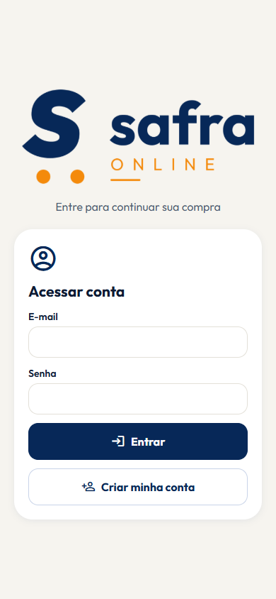
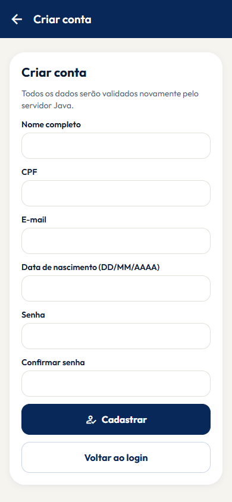
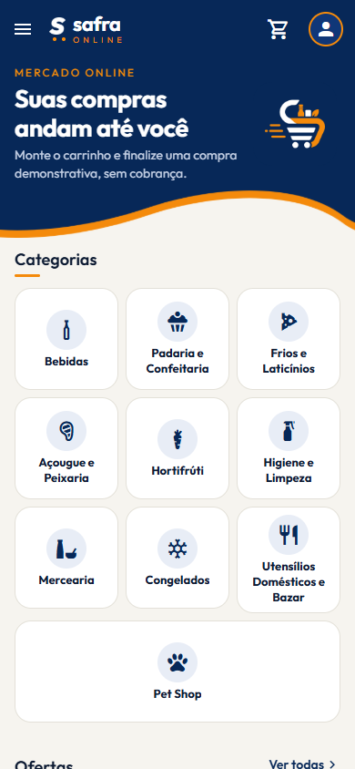
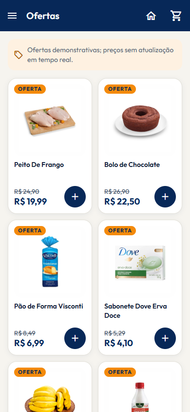
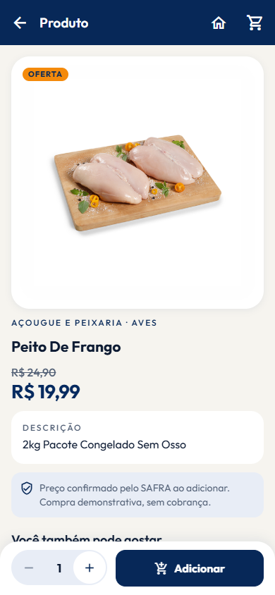
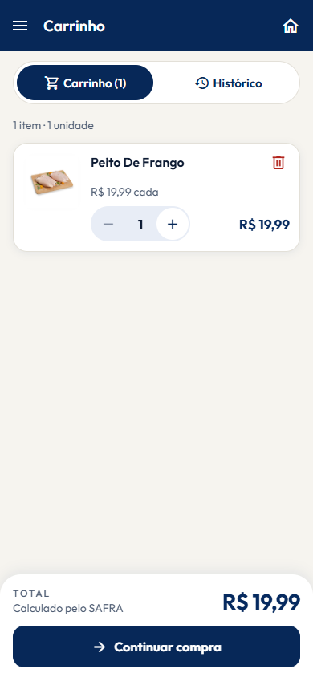
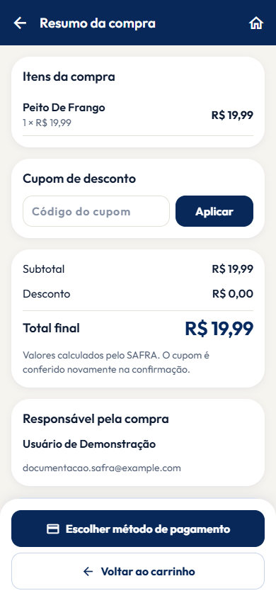
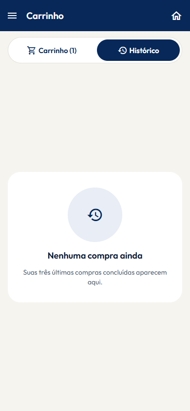
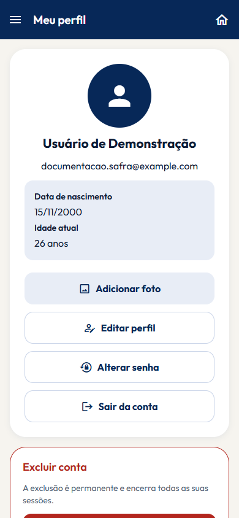
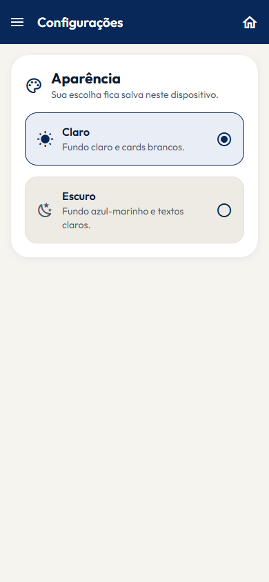

# SAFRA Online — Documento de Projeto

**Curso:** Sistemas de Informação — Projeto Integrador IV — 2026/2  
**Grupo:** PROJETO-0101 — Grupo 01  
**Versão do documento:** 1.3 — 23 de novembro de 2026  
**Versões entregues:** backend 1.5.0, servidor Java 0.4.0 e aplicativo 1.4.0

## Integrantes e papéis

| Integrante | RA | Responsabilidade principal |
|---|---:|---|
| Alex Hideki Nakamura Novaes | 25007991 | Servidor Java, socket TCP, Docker e backend |
| Felipe Gabriel Freire Parra | 25003341 | API Node.js, PostgreSQL e Docker |
| João Pedro Rocha | 25003959 | Aplicativo React Native e design |
| João Vitor Peres Peternella | 25004637 | Documentação, diagramas e apoio ao frontend |
| Marcelo Muller Del Mondo | 25000638 | Aplicativo React Native e design |

## 1. Visão geral

**Responsável:** João Vitor Peres Peternella.

O SAFRA Online é um aplicativo acadêmico de supermercado digital. A versão entregue permite cadastrar e autenticar consumidores, navegar por um catálogo de 237 produtos, filtrar setores e ofertas, montar o carrinho, aplicar cupons, confirmar uma compra demonstrativa e consultar ou repetir as três compras mais recentes.

O sistema não realiza cobrança real, entrega, controle administrativo de estoque nem integração com mercados externos. O assistente de compras com inteligência artificial, previsto inicialmente nas ADRs e nos contratos CT19 a CT21, foi retirado desta versão por limitação de tempo e pelo pouco domínio do grupo sobre o tema. A decisão evitou acrescentar uma integração instável ao fluxo principal; os contratos foram preservados como planejamento de evolução futura.

## 2. Objetivos

**Responsável:** João Vitor Peres Peternella.

- Disponibilizar uma experiência responsiva de compras demonstrativas em celular e navegador.
- Manter catálogo, carrinho, contas, cupons e histórico em PostgreSQL.
- Atender ao requisito acadêmico com um servidor Java 21 convencional, gerenciado por Maven e acessado por socket TCP.
- Trocar strings JSON por linha entre Node.js e Java usando `BufferedReader` e `PrintWriter`, sem serialização nativa Java.
- Aplicar validações de cadastro, autenticação, idade, cupom e confirmação no servidor.
- Permitir execução reproduzível com Docker Compose e testes automatizados.

## 3. Requisitos

**Responsáveis:** Felipe Gabriel Freire Parra e Alex Hideki Nakamura Novaes.

### 3.1 Requisitos funcionais e situação

| ID | Entregável | Situação |
|---|---|---|
| E1–E3 | Catálogo, setores, subcategorias e detalhes dos produtos | Pronto |
| E4–E8 | Adição, alteração, remoção, totais e resumo do carrinho | Pronto |
| E9 | Confirmação demonstrativa idempotente | Pronto |
| E10 | Interface responsiva com temas claro e escuro | Pronto |
| E11 | Assistente de compras com IA | Cortado desta versão |
| E12 | Ofertas com preço anterior e atual | Pronto |
| E13 | Cadastro, autenticação, perfil, foto e exclusão da conta | Pronto |
| E14 | Cupons `PRIMEIRA40` e `QUERO100` | Pronto |
| E15 | Últimas três compras, detalhes e repetição | Pronto |

### 3.2 Requisitos não funcionais

- O ambiente oficial sobe com `docker compose up -d --build`.
- Migrations e seed são repetíveis sem duplicar dados.
- A indisponibilidade do Java não derruba catálogo e carrinho; operações dependentes retornam 503.
- O socket tem timeout e limite de 32 KiB por mensagem.
- Senhas usam Argon2id; tokens de sessão são aleatórios e somente seu SHA-256 é persistido.
- Valores monetários usam `NUMERIC` no PostgreSQL e `BigDecimal` no Java.
- A chave de idempotência impede a duplicação de uma compra confirmada.
- O Java aceita `PedidoParaSair`, envia `ComunicadoDeDesligamento` e encerra recursos ordenadamente.
- Fotos JPEG, PNG ou WebP respeitam limite configurável, com padrão de 10 MB.

### 3.3 Autenticação, segurança e privacidade

O aplicativo envia credenciais por HTTP/JSON à API Node.js. A API atua como cliente TCP do servidor Java, que valida os campos, verifica a senha Argon2id e cria a sessão. O token completo volta somente ao cliente; o banco mantém seu hash SHA-256. Rotas protegidas exigem `Authorization: Bearer <token>`.

O projeto não armazena dados de cartão nem efetua cobrança. Nome, CPF, e-mail, telefone, nascimento, foto e histórico são usados apenas nos fluxos acadêmicos. A exclusão remove conta, sessões e foto, enquanto compras demonstrativas permanecem anonimizadas para integridade do histórico.

## 4. Arquitetura

**Responsáveis:** Alex Hideki Nakamura Novaes e Felipe Gabriel Freire Parra.

```text
Aplicativo Expo
     | HTTP/JSON
     v
API Node.js + Express ---- arquivos de foto
     |             \
     | TCP/JSON     \ SQL
     v               v
Servidor Java ---> PostgreSQL
ServerSocket/JDBC
```

- O aplicativo cuida da interface, navegação e sessão local.
- A API fornece rotas HTTP, catálogo, carrinho, arquivos e o cliente TCP.
- O Java 21 é um projeto Maven sem Spring. Ele abre manualmente um `ServerSocket` e executa validações, autenticação, idade, cupons, histórico e confirmação.
- Cada `Socket` é associado a um `BufferedReader` e a um `PrintWriter` UTF-8. As mensagens são strings JSON delimitadas por `LF`; não há `Serializable`, `ObjectInputStream` ou `ObjectOutputStream`.
- `AceitadoraDeConexao` e `SupervisoraDeConexao` implementam `Runnable` e usam `ExecutorService`.
- O PostgreSQL mantém integridade, valores decimais, idempotência e persistência.
- Docker Compose é a forma recomendada de empacotar e executar os serviços, mas o servidor acadêmico é a aplicação Java, não o Docker.

No desligamento, `PedidoParaSair` inicia uma sequência única: o servidor deixa de aceitar conexões, envia `ComunicadoDeDesligamento` a todos os clientes ativos, aguarda o prazo de leitura e fecha sockets, executores e o pool do banco.

## 5. Banco de dados

**Responsável:** Felipe Gabriel Freire Parra.

O PostgreSQL 17.11 é compartilhado pela API e pelo servidor Java. O esquema é criado por oito migrations versionadas: catálogo; carrinhos e compras; usuários e sessões; perfil e restrição etária; classificação de alcoólicos; imagem opcional; curadoria, cupons e histórico; e atualização de produto.

As entidades centrais são `usuarios`, `sessoes_usuario`, `categorias`, `subcategorias`, `produtos`, `carrinhos`, `itens_carrinho`, `compras_demonstrativas`, `itens_compra`, `cupons` e `usos_cupom`. Chaves estrangeiras e constraints preservam os vínculos; valores monetários usam `NUMERIC` e as operações críticas usam transações.

## 6. Contratos e decisões

**Responsáveis:** João Vitor Peres Peternella e Alex Hideki Nakamura Novaes.

Os contratos CT1 a CT27 estão em [`docs/contratos`](contratos/README.md): CT1–CT7 cobrem catálogo; CT8–CT14, carrinho; CT15–CT18, confirmação; CT22, ofertas; CT23, conta; CT24–CT25, histórico; e CT26–CT27, cupons. CT19–CT21 descrevem a IA adiada.

O protocolo TCP está em [`TCP-JSON.md`](contratos/TCP-JSON.md). As decisões arquiteturais ficam em [`docs/adr`](adr), com destaque para a substituição do HTTP interno por TCP/JSON e para o servidor Java Maven sem Spring.

## 7. Testes

**Responsáveis:** Alex Hideki Nakamura Novaes e Felipe Gabriel Freire Parra.

O backend usa `node:test`, Supertest e PostgreSQL temporário real. A suíte cobre catálogo, curadoria, carrinho, confirmação, cupons, histórico, cliente TCP e desligamento administrativo. O Java usa JUnit Jupiter e AssertJ para configuração, validação, cupons, parceiro TCP, servidor, senha e usuários.

Comandos principais:

```powershell
npm test
docker compose run --rm --no-deps confirmacao-java-test
```

O roteiro completo, incluindo testes integrados e evidências, está em [`docs/VALIDACAO.md`](VALIDACAO.md).

## 8. Principais telas

**Responsáveis:** João Pedro Rocha e Marcelo Muller Del Mondo.

### 8.1 Login



Usada pelo consumidor para autenticar a conta. Atende ao entregável E13.

### 8.2 Cadastro



Coleta e valida os dados necessários para criar uma conta. Atende ao E13 e às validações do servidor Java.

### 8.3 Início



Apresenta setores, ofertas e produtos ao consumidor. Atende a E1, E2, E10 e E12.

### 8.4 Ofertas



Exibe os produtos promocionais, com preços anterior e atual. Atende ao E12.

### 8.5 Produto



Mostra classificação, imagem, descrição, preço e controles de quantidade. Atende a E3 e E4.

### 8.6 Carrinho



Permite revisar itens, mudar quantidades, remover produtos e abrir o resumo. Atende a E4–E8.

### 8.7 Resumo da compra



Confirma itens e valores, aceita cupom e conclui a compra demonstrativa. Atende a E8, E9 e E14.

### 8.8 Histórico



Mostra as três compras mais recentes e permite repetir uma compra. Atende ao E15.

### 8.9 Perfil



Permite ao consumidor consultar e alterar nome, telefone e foto. Atende ao E13.

### 8.10 Configurações



Reúne tema, troca de senha, saída e exclusão da conta. Atende a E10 e E13.

## 9. Como rodar

**Responsáveis:** Alex Hideki Nakamura Novaes e Felipe Gabriel Freire Parra.

Este capítulo corresponde à seção **Entrega final — como rodar** do [`README.md`](../README.md), na raiz do repositório principal. O texto abaixo reproduz o roteiro essencial da entrega para manter a versão em Markdown e o PDF autocontidos.

### 9.1 Repositórios

- Backend, Java, banco e Docker: <https://github.com/Rnchx/pi4-TURMA-gN-backend-1>
- Aplicativo Expo: <https://github.com/Rnchx/pi4-TURMA-gN-frontend>

### 9.2 Pré-requisitos

- Git 2.40 ou superior.
- Docker Desktop com Docker Compose v2.
- Node.js 22 e npm para executar o aplicativo Expo.
- Expo Go atualizado no celular, se o teste for feito em dispositivo físico.

### 9.3 Subir o backend do zero

```powershell
git clone https://github.com/Rnchx/pi4-TURMA-gN-backend-1.git
cd pi4-TURMA-gN-backend-1
Copy-Item .env.example .env
docker compose up -d --build
docker compose ps
Invoke-RestMethod http://localhost:4000/health/ready
```

O Compose cria o PostgreSQL, aplica migrations e seed e inicia o servidor Java TCP e a API Node.js. O resultado esperado do healthcheck é HTTP 200 com banco e Java disponíveis.

### 9.4 Subir o aplicativo

```powershell
git clone https://github.com/Rnchx/pi4-TURMA-gN-frontend.git
cd pi4-TURMA-gN-frontend
npm ci
Copy-Item .env.example .env.local
```

Em `.env.local`, use `EXPO_PUBLIC_API_URL=http://localhost:4000` para o navegador. Para celular na mesma rede, use `http://IP_DO_COMPUTADOR:4000`. Depois:

```powershell
npx expo start --lan --clear
```

Pressione `w` para abrir no navegador ou escaneie o QR Code no Expo Go. Cadastre uma conta e percorra início, produto, carrinho, resumo, cupom, confirmação, histórico e perfil. As compras são demonstrativas, sem cobrança.

Para encerrar o ambiente:

```powershell
docker compose down
```

## 10. Conclusão

**Responsável:** João Vitor Peres Peternella.

A entrega cumpre o fluxo principal de um supermercado digital acadêmico e integra Expo, Node.js, Java TCP e PostgreSQL. O servidor Java participa efetivamente de validações e operações transacionais, usa o modelo de sockets solicitado e oferece desligamento ordenado. Docker Compose reduz o custo de preparação do ambiente, enquanto contratos, ADRs, migrations e testes tornam as decisões rastreáveis. A IA permanece como evolução futura, fora da versão entregue.

## 11. Anexos

**Responsável:** João Vitor Peres Peternella.

- [Contratos HTTP e TCP](contratos/README.md)
- [ADRs](adr)
- [Roteiro de validação](VALIDACAO.md)
- [CHANGELOG](../CHANGELOG.md)
- [README do backend](../README.md)
- [Release v1.5.0](https://github.com/Rnchx/pi4-TURMA-gN-backend-1/releases/tag/v1.5.0)
- [Quadro do projeto](https://srv1889234.hstgr.cloud/projects/pi-iv-0101-g1/sprints/4/taskboard)
